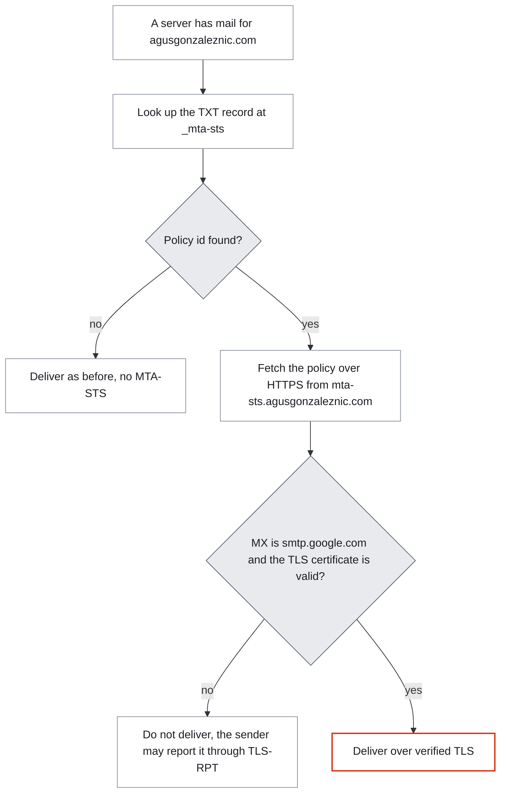
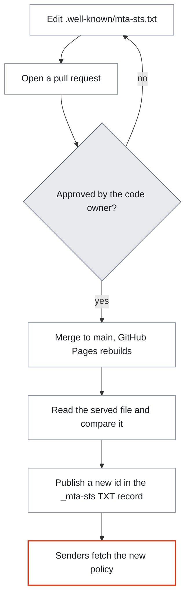

<div align="center">


# 🔐 mta-sts

### The MTA-STS policy for agusgonzaleznic.com, served from GitHub Pages.

**This repository is the policy host. It publishes one small text file that tells other mail servers
to deliver mail for agusgonzaleznic.com only over verified TLS, to the mail server named in the
file.** No code, no build step, no backend. A change to the policy is a pull request.

<br>


<br>


<br>

**[What this is](#-what-this-is) · [The policy](#-the-policy) · [How it works](#-how-it-works) · [Changing it](#-changing-the-policy) · [Hosting](#-hosting) · [Layout](#-repository-layout) · [Limits](#-what-this-does-not-do) · [Contributing](#-contributing) · [Support](#-support-this-project)**

</div>

---

## 🧭 What this is

Email between servers is encrypted only when both sides agree to it, and a network attacker can
make them disagree. MTA-STS ([RFC 8461](https://www.rfc-editor.org/rfc/rfc8461)) closes that gap: the
receiving domain publishes a policy, and a sending server that supports the standard refuses to
deliver in plain text or to a server the policy does not name.

I host that policy for my own domain here. Three pieces make it work, and this repository is one
of them.

| Piece | Where it lives | What it does |
|---|---|---|
| Policy file | this repository, served at `https://mta-sts.agusgonzaleznic.com/.well-known/mta-sts.txt` | States the mode, the allowed mail servers and how long a sender may cache the policy |
| `_mta-sts` TXT record | DNS for agusgonzaleznic.com | Tells senders a policy exists and carries its `id`, which changes whenever the policy does |
| `_smtp._tls` TXT record | DNS for agusgonzaleznic.com | Asks senders to send TLS-RPT failure reports to the mailbox the record names |

---

## 📜 The policy

The file below is what the site serves (checked on 14 November 2026).

```text
version: STSv1
mode: enforce
mx: smtp.google.com
max_age: 604800
```

| Field | Value | Meaning |
|---|---|---|
| `version` | `STSv1` | The only version the standard defines |
| `mode` | `enforce` | A sending server must not deliver mail that cannot meet the policy |
| `mx` | `smtp.google.com` | The one mail server name a sender may deliver to |
| `max_age` | `604800` | Seven days, in seconds: how long a sender may reuse the policy without fetching it again |

The DNS side, as of 14 November 2026:

| Record | Value |
|---|---|
| `MX` for agusgonzaleznic.com | one record, priority 1, `smtp.google.com.` |
| `TXT` at `_mta-sts` | `v=STSv1;id=1744722000;` |
| `TXT` at `_smtp._tls` | `v=TLSRPTv1;` plus a `rua=` address, so reports go to the mailbox the record names |

The `mx` line matches the only MX record, so the policy and the DNS agree.

---

## 🧩 How it works



The sender caches the policy for up to `max_age`. A new `id` in the `_mta-sts` record is its signal
to fetch the policy again before then.

---

## 🔁 Changing the policy

A change has two halves, and the order matters: the file goes live first, the new `id` second. If the
`id` changes before the file does, senders fetch the old policy and cache it again.



1. Edit [`.well-known/mta-sts.txt`](.well-known/mta-sts.txt) on a branch and open a pull request.
2. After the merge, wait for Pages to rebuild, then fetch
   `https://mta-sts.agusgonzaleznic.com/.well-known/mta-sts.txt` and check that it shows the change.
3. In DNS, give the `_mta-sts` TXT record a new `id`. Any string of letters and digits up to 32
   characters works, as long as it differs from the last one. The current value, `1744722000`,
   looks like a Unix timestamp.

Two cases deserve care. Adding a mail server means adding its `mx:` line before the MX record
changes, because in `enforce` mode a sender refuses any server the policy does not name. And
lowering `max_age` does not take effect quickly: senders keep the old policy for as long as they
cached it, up to seven days.

---

## 🌐 Hosting

GitHub Pages serves the repository as is, and no workflow of mine runs. These settings are read from the
Pages API as of 14 November 2026.

| Setting | Value |
|---|---|
| Source | branch `main`, folder `/`, legacy build |
| Custom domain | `mta-sts.agusgonzaleznic.com`, set by the [`CNAME`](CNAME) file |
| HTTPS | enforced, with a certificate for that host that GitHub issues and renews |
| Visibility | public |

The `.nojekyll` file turns off Jekyll, so every file in the repository is published unchanged, this
README included. [`_config.yml`](_config.yml) also lists `.well-known` explicitly.

The policy URL answers with the file directly and no redirect, since the standard does not let a
sender follow one. The two `index.html` files only redirect a person who opens the site root or
the `.well-known` folder in a browser, and [`robots.txt`](robots.txt) asks crawlers to stay out.

---

## 📁 Repository layout

| Path | What it is |
|---|---|
| [`.well-known/mta-sts.txt`](.well-known/mta-sts.txt) | The policy. The only file that matters to a sending server |
| [`.well-known/index.html`](.well-known/index.html) | Browser redirect from the folder to the policy file |
| [`index.html`](index.html) | Browser redirect from the site root to the policy file |
| [`robots.txt`](robots.txt) | Disallows all crawling |
| [`CNAME`](CNAME) | Binds the Pages site to `mta-sts.agusgonzaleznic.com` |
| [`.nojekyll`](.nojekyll) | Publishes files as they are, with no Jekyll processing |
| [`_config.yml`](_config.yml) | Includes the `.well-known` folder in the site |
| [`.github/CODEOWNERS`](.github/CODEOWNERS) | Makes me the code owner of everything |
| [`.github/FUNDING.yml`](.github/FUNDING.yml) | Feeds the repository's Sponsor button |
| [`assets/emblem.svg`](assets/emblem.svg) | The emblem at the top of this README |
| [`LICENSE.md`](LICENSE.md) | MIT licence |

---

## 🚧 What this does not do

- **It does not manage DNS.** The `_mta-sts` and `_smtp._tls` records live in DNS and change there
  after a policy change. Nothing in this repository checks that they match the file.
- **It does not run tests or checks.** There is no workflow: no validation of the policy syntax, no
  comparison against the MX record.
- **It does not read TLS reports.** The reports go to the mailbox the TLS-RPT record names, and
  nothing here processes them.
- **It does not set up SPF, DKIM or DMARC.** MTA-STS only governs transport encryption between servers.
- **It does not protect mail from senders that ignore the standard.** A sending server has to
  support MTA-STS for the policy to bind it.
- **It hosts one domain.** The policy covers agusgonzaleznic.com and nothing else.

---

## 🤝 Contributing

The policy describes my own mail setup, so it changes only when my setup does. A typo or a clearer
sentence in this README is welcome as a pull request.

The `main` branch is protected by a ruleset (read from the API on 14 November 2026): changes arrive
through a pull request with one approval, a code owner must review it, commits must be signed, history
stays linear, and the branch cannot be deleted or force-pushed.

---

## 💛 Support this project

It is free and small. If a clear example of MTA-STS on GitHub Pages saved you an afternoon, a coffee
or a sponsorship is a kind way to say so. Ko-fi is a one-off, and GitHub Sponsors
can be monthly or one-time, with a custom amount.

<div align="center">
<br>

[](https://ko-fi.com/agusgonzaleznic)
[](https://github.com/sponsors/agusgonzaleznic)
<br>
[](https://agusgonzaleznic.com)
[](https://github.com/agusgonzaleznic)
[](https://www.linkedin.com/in/agusgonzaleznic)

<br>

<sub>Built in Berlin by <b>Agustin Gonzalez Nicolini</b>. I work on engineering leadership and write
about it at <a href="https://agusgonzaleznic.com">agusgonzaleznic.com</a>.</sub>

</div>

---

## 📄 Licence

[MIT](LICENSE.md), copyright 2025 Agustin Gonzalez Nicolini. You are free to copy the setup for your
own domain.
